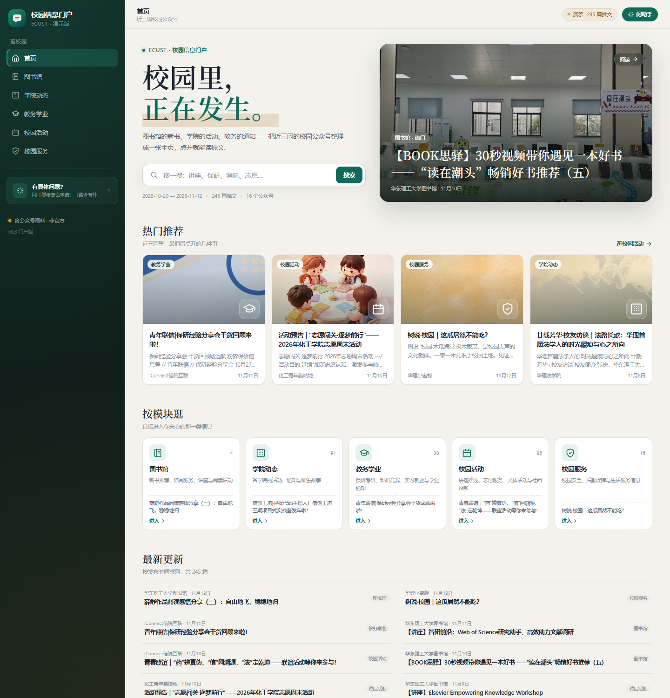
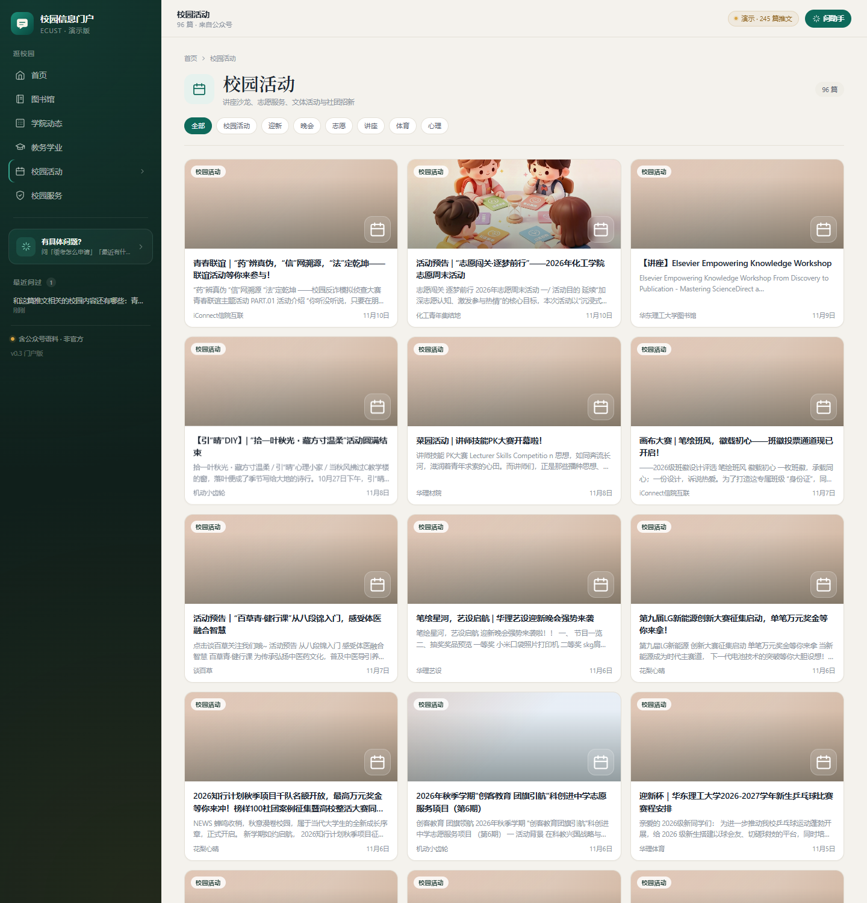
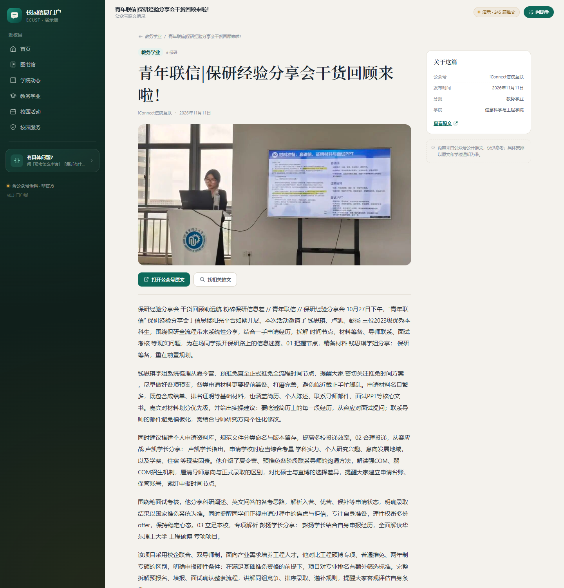
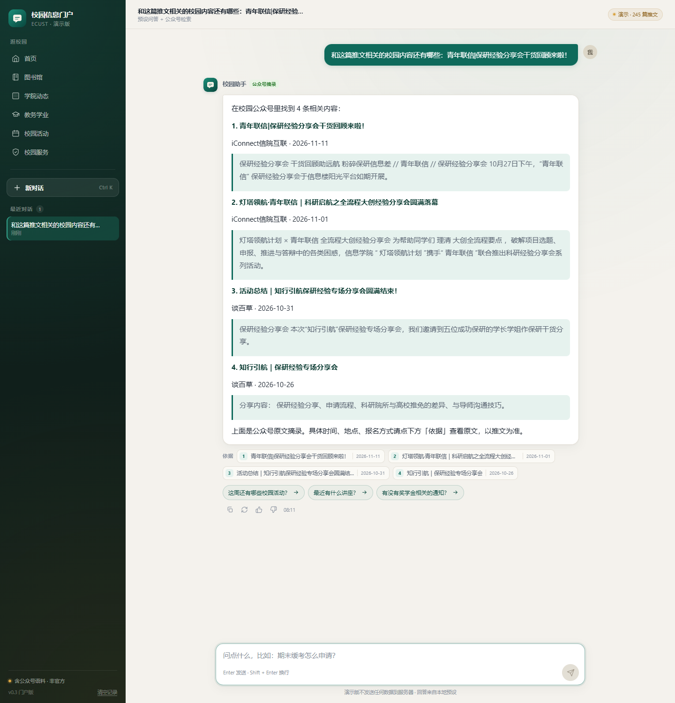
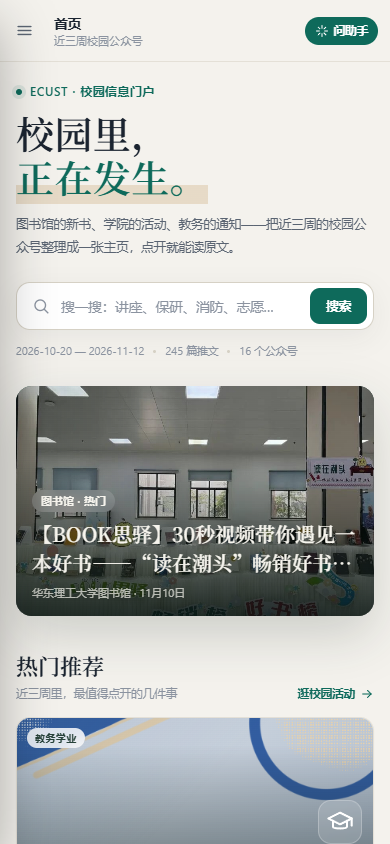

# 校园信息门户 · Web 演示版

面向华东理工大学的校园信息门户原型：首页像浏览器主页一样推荐近期热门，按「图书馆 / 学院动态 / 教务学业 / 校园活动 / 校园服务」分区浏览，智能问答作为其中一个模块，而不是整站。

**当前阶段：纯前端 Demo。** 不接数据库、不调大模型 API。数据来自 `ecust-rag-kb` 的公众号快照（2026-10-20 ~ 2026-11-12）：

- **门户内容**：245 篇推文，按模块和 12 个学院分类，支持列表、筛选、详情、全文阅读；
- **智能助手**：18 条办事预设 + 653 个语料切块，浏览器里用 BM25 检索，回答带出处和原文链接。

> 公众号内容版权归原作者，不代表学校官方发布；正式版以学校通知为准。



## 快速开始

要求 Node.js 20+。

```bash
npm install
npm run dev             # http://127.0.0.1:5178
npm run build           # 类型检查 + 生产构建，产物在 dist/
npm run preview         # 预览构建产物，http://127.0.0.1:4178
```

数据脚本：

```bash
npm run import-corpus   # chunks.jsonl → public/corpus.json + src/data/corpus-meta.json
npm run build-portal    # documents.jsonl + content-cache.json → public/portal.json + public/articles.json
```

两个脚本默认读取 `../ecust-rag-kb`，也可以显式传路径：

```bash
npm run import-corpus -- "D:\path\to\chunks.jsonl"
npm run build-portal -- . "D:\path\to\ecust-rag-kb"
```

`build-portal` 生成：

- `public/portal.json`：模块统计、学院统计、6 篇 featured、8 条最新、全部文章元数据（约 266 KB）
- `public/articles.json`：`{docId: 正文}`，详情页按需懒加载（约 766 KB）

## 页面与路由

没有引入 vue-router，用轻量 hash 路由，刷新和前进/后退都可用。

| 路由 | 页面 | 说明 |
|---|---|---|
| `#/` | 首页 | hero 热门头条、4 张热门推荐、5 个模块入口、最新更新 |
| `#/library` | 图书馆 | 新书推荐、借阅服务、讲座与阅读活动 |
| `#/college` | 学院动态 | 12 个学院筛选，各学院活动、通知、师生故事 |
| `#/college/<学院名>` | 学院筛选 | 例如 `#/college/信息科学与工程学院` |
| `#/academic` | 教务学业 | 保研、考研、科研、竞赛、实习就业、考试通知 |
| `#/activity` | 校园活动 | 讲座、晚会、志愿、体育、心理、社团 |
| `#/service` | 校园服务 | 校园安全、后勤、反诈、校医院、生活服务 |
| `#/article/<id>` | 文章详情 | 封面、正文分段、打开公众号原文、找相关推文 |
| `#/search/<关键词>` | 全站搜索 | 标题、摘要、公众号、学院全字段匹配 |
| `#/assistant` | 智能助手 | 原问答页整体搬入，支持 `?q=` 直接提问 |

侧栏是全站导航；只有进入「智能助手」后才显示「新对话 / 最近对话」。顶部栏根据页面显示标题和面包屑信息，右侧常驻「问助手」入口。





## 已实现的功能

**门户**

- 首页 hero 大图 + 「热门推荐」4 张带图卡，按分类多样性、时效、标题热度综合排序。
- 5 个模块入口，每个显示文章数和最新一条标题，点进去就是该模块列表。
- 学院页 12 个学院 chips，带数量，可直接筛选。
- 模块页标签 chips、3 列卡片网格、每次加载 18 条、空态。
- 文章详情页：封面、标题、公众号/日期、分类、学院、正文按 3 句分段、右侧信息卡、底部同类推荐。
- 全站搜索，结果按标题/摘要/公众号/学院匹配。
- 响应式：桌面侧栏常驻；小于 900px 侧栏变抽屉，卡片单列。

**智能助手**

- 18 条高频办事预设：补办学生证、缓考、校园卡挂失、转专业、奖学金、三方协议等。
- 公众号检索：问「最近有什么讲座」「这周有哪些校园活动」「保研经验分享」会返回相关推文和摘录。
- 预设优先：办事类问题优先用整理好的答案；只有未命中预设、或带「最近 / 这周 / 最新」等时效词时才查语料，避免拿活动推文冒充政策。
- 来源可查：回答附依据 chip，公众号来源可跳 `mp.weixin.qq.com` 永久链。
- 模拟流式、停止生成、连续追问、复制、重新生成、赞踩。
- 会话存在 `localStorage`，刷新不丢。
- 快捷键：`Ctrl/Cmd + K` 去助手 / 新对话；`Enter` 发送，`Shift + Enter` 换行。



## 数据与分类

### 语料规模

| 指标 | 数值 |
|---|---|
| 文章 | 245 篇（清洗后 244 篇进入检索，653 块） |
| 公众号 | 16 个 |
| 正文 | 约 163 万字 |
| 时间范围 | 2026-10-20 ~ 2026-11-12 |

模块分布：图书馆 4、学院动态 91、教务学业 38、校园活动 96、校园服务 16。

**这不是全量历史。** 只有近三周，适合验证「近期活动 / 讲座 / 评优通知 / 保研分享」类内容；教务政策、培养方案这类需要长期文档的问题仍由 18 条预设兜底。

### 分类规则

按标题关键词依次判断：

```
library  → service → academic → activity → college（默认）
```

- `library`：图书馆、借阅、书香、文献、读书
- `service`：校医院、消防、安全、反诈、后勤、保卫、生活服务
- `academic`：保研、考研、科研、竞赛、就业、考试、实习、奖学金
- `activity`：讲座、活动、晚会、志愿、体育、心理、社团、联谊
- `college`：其余学院动态、师生故事、通知

### 学院映射

16 个公众号映射到 12 个学院/单位：社想→社会与公共管理学院、iConnect→信息科学与工程学院、材院→材料科学与工程学院、法学→法学院、体育→体育科学与工程学院、机动→机械与动力工程学院、外语→外国语学院、花梨心晴→心理健康教育中心、谈百草→药学院、艺设→艺术设计与传媒学院、物院→物理学院、数学→数学学院、化工→化工学院、图书馆→图书馆、小蜜蜂→校园服务、平安华理→保卫处。

### 封面策略

- `cover`：优先取文章内第一张 JPG 照片（宽 ≥ 360），没有 JPG 才退回 PNG；用于 hero 和详情页。
- `texture`：第一张宽 PNG 背景纹理，用于列表卡片，配分类色 tint 和图标，避免卡片直接出现「求关注 / 二维码」海报。
- 微信图片有防盗链，所有 `` 必须带 `referrerpolicy="no-referrer"`，否则会显示「此图片来自微信公众号 未经许可不可引用」占位图。
- 封面选择仍是启发式：部分文章首图是二维码/宣传海报，正式版应加人工精选或图像质量模型。

## 目录结构

```
campus-assistant/
├── scripts/
│   ├── import-corpus.mjs        # chunks.jsonl → corpus.json + corpus-meta.json
│   └── build-portal.mjs         # documents + content-cache → portal.json + articles.json
├── public/
│   ├── corpus.json              # 助手检索语料（约 1.1MB）
│   ├── portal.json              # 门户元数据（约 266KB）
│   └── articles.json            # 文章正文（约 766KB，按需加载）
├── src/
│   ├── components/
│   │   ├── PortalHome.vue       # 首页
│   │   ├── ModulePage.vue       # 模块列表 / 学院筛选
│   │   ├── ArticlePage.vue      # 文章详情
│   │   ├── SearchPage.vue       # 全站搜索
│   │   ├── AssistantPage.vue    # 智能助手
│   │   ├── ArticleCard.vue      # 文章卡片（grid/row/compact）
│   │   ├── AppSidebar.vue       # 全站导航
│   │   └── ...                  # 消息、输入框、来源抽屉、Toast
│   ├── data/knowledge.ts        # 18 条办事预设
│   ├── services/
│   │   ├── matcher.ts           # 预设关键词匹配
│   │   ├── corpusSearch.ts      # 浏览器端 BM25 + 摘要
│   │   └── answerEngine.ts      # 路由 + 假流式；接真实 API 只改这个文件
│   ├── stores/
│   │   ├── chat.ts              # 会话状态 + localStorage
│   │   └── portal.ts            # portal.json 懒加载
│   ├── utils/portal.ts          # 模块元信息、日期、封面样式
│   ├── router.ts                # hash 路由
│   └── styles/main.css          # 设计变量、Markdown、标签
└── docs/screenshots/
```

技术栈：Vue 3 + TypeScript + Vite；`marked` + `DOMPurify`；无 UI 组件库，样式手写，方便按学校 VI 调整。

## 助手是怎么跑的

1. 用户提问进入 `src/stores/chat.ts` 的 `send()`；
2. `answerEngine.streamAnswer()` 先调 `matcher.matchKnowledge()` 匹配 18 条预设；
3. 预设命中且无时效词 → 直接用预设答案；
4. 预设未命中，或带时效词 → 调 `searchCorpus()` 查公众号语料；
5. 命中 → 生成「找到 N 条相关内容」的摘录式回答，附 4 个来源；未命中 → 兜底文案；
6. 回答按 2–4 字一段、约 20ms 一段吐出，模拟大模型流式输出；
7. 点「依据」打开右侧抽屉，公众号来源可跳原文。

### 检索细节

- 中文按字符 bigram，拉丁按单词；不引分词库。
- BM25：`k1=1.2`、`b=0.75`；标题重复 3 次并入正文，标题命中额外 `idf × 1.8`。
- 时效：`1 + 0.18 × exp(-ageDays / 12)`。
- 门槛：必须有标题命中，且 `覆盖率 ≥ 0.6` 或 `分数 ≥ 10`；按 `docId` 去重，最多 4 篇。
- 摘要：取该文章 `chunkIndex` 最小的首块，再挑和查询词重合最多的句子，最多 170 字；纯英文内容提示「请点开原文」。

**局限**：BM25 不懂语义，同义改写会漏；字符 bigram 会误匹配。只适合当前 Demo 规模，正式版应换成服务端混合检索（bge-m3 dense + sparse + BM25 → RRF → rerank）。

## 项目分块

整个产品拆成 9 块。当前 Demo 完成了 G 的门户 + 助手界面，以及 A/B/C/D/E 的轻量版本；F、H、I 还没开始。

| # | 模块 | 职责 | 建议技术 | 当前状态 |
|---|------|------|----------|----------|
| A | 数据源与采集 | 公众号通知/活动；后期接学校开放接口 | 采集器、合规抓取、增量同步 | 部分完成（245 篇快照） |
| B | 文档解析与清洗 | HTML → 正文、标题、图片、元数据 | Readability、cheerio、Pillow | 部分完成 |
| C | 知识组织与切块 | 模块/学院/学期/文号元数据，500–800 字块 | 规则 + 人工校验；PostgreSQL | 部分完成（653 块） |
| D | 检索与重排 | 向量 + 稀疏 + BM25 混合召回、RRF、精排 | bge-m3、Qdrant、RRF(k=60)、bge-reranker | Demo（浏览器 BM25），生产未开始 |
| E | 问答编排 | 意图识别、查询改写、Prompt、引用、拒答 | DeepSeek 主模型 + Qwen/GLM 兜底 | Demo（预设 + 语料路由），LLM 未接 |
| F | 后端服务 | 门户/检索/对话/知识管理接口 | FastAPI + PostgreSQL + Qdrant + Redis | 未开始 |
| G | Web 端 | 门户、模块、详情、搜索、助手 | Vue 3 + TypeScript + Vite | **完成（演示版）** |
| H | App 端 | iOS/Android，复用同一套接口 | uni-app 或小程序原生 | 未开始 |
| I | 评测与运维 | 金标集、召回率/忠实度、回归门禁 | 120 题评测集 + 脚本化评测 | 未开始 |

### 各块的衔接关系

```
A 采集 → B 解析 → C 切块/元数据 → D 建索引
                                      ↓
用户 → G Web 门户（首页/模块/详情/搜索）
                                      ↓
                               E 助手编排 → F 接口
                                      ↓
                                  I 评测与监控
```

Demo 里 D 和 E 跑在浏览器，门户数据是构建时生成的静态 JSON；正式版应整体移到 F，前端只负责展示和调接口。

## 接真实后端时改哪里

### 门户数据

把 `portal.json` / `articles.json` 换成接口：

```ts
GET /api/portal                      // 首页、模块统计、featured、latest
GET /api/articles?module=activity&college=...&page=1
GET /api/articles/:id                // 详情 + 正文
GET /api/search?q=...
```

`src/stores/portal.ts` 的 `loadPortal()` 和 `ArticlePage.vue` 的正文加载是唯一需要改的地方。

### 助手

只需要替换 `src/services/answerEngine.ts`，保持契约不变：

```ts
export interface StreamHandlers {
  onStatus?: (status: 'thinking' | 'streaming') => void
  onSources: (sources: SourceRef[]) => void
  onToken: (text: string) => void
  onDone: (meta: { matched: boolean; followups: string[] }) => void
}

export async function streamAnswer(
  question: string,
  handlers: StreamHandlers,
  signal: AbortSignal,
): Promise<void>
```

后端建议用 SSE：

```
event: sources
data: [{"id":"...","title":"...","department":"...","date":"...","tag":"公众号","excerpt":"...","url":"https://mp.weixin.qq.com/s/..."}]

event: token
data: {"text":"根据"}

event: done
data: {"matched":true,"followups":["..."]}
```

前端把 `streamAnswer` 改成 `fetch('/api/chat')` + `ReadableStream` 解析即可；`signal` 继续用于「停止生成」。

## 路线图

**P0 · 门户 Demo（当前，已完成）**
- 首页热门推荐、5 个模块、学院筛选、文章详情、全站搜索
- 18 条办事预设 + 245 篇公众号内容，本地 BM25
- 助手降为独立模块，来源可跳原文

**P1 · 内容底座（建议下一步）**
- 把语料从 3 周扩到 1–2 年，补教务/政策/办事指南类长期文档
- 采集、解析、切块、索引挪到服务端，前端调只读接口
- 建 50 题评测集，看「该命中的有没有命中、不该命中的有没有乱答」
- 给门户加人工精选头条 / 封面质量筛选，替换纯启发式

**P2 · 接入 LLM 与 RAG**
- bge-m3 建向量索引，混合检索 + RRF + 精排
- 接 DeepSeek 等 API，SSE 流式输出，强制带引用
- 建 120 题金标集，记录召回率、引用准确率、拒答率
- 加「回答有效性检查」：引用对不上就降级为「请查看原文」

**P3 · 双端与运营**
- uni-app 复用接口做 App；或先做微信小程序
- 账号体系、收藏、反馈闭环、badcase 回流
- 与学校谈接口/授权，替换抓取链路

## 注意事项

- **合规**：公众号文章有版权，采集前确认使用范围；不要抓取非公开内容，不要绕过登录/付费墙。正式对外前需要学校授权。
- **语料敏感文件**：`ecust-rag-kb` 里的 `.token`、`accounts.txt`、`collector/we-mp-rss/data/.secret_key`、`key.lic`、`wx.lic`、`db.db` 含登录态或授权信息，**不要提交、不要外传**。
- **准确性**：校园信息有时效性（选课时间、考试安排），回答必须带发布日期和原文链接，过期内容要标注。
- **隐私**：只展示公开信息；不接入学号、成绩、一卡通余额等个人数据，除非后续做统一身份认证并明确授权。
- **演示标识**：顶部 chip、侧栏和回答 badge 都有「演示」提示；公众号内容请点开原文核对。

## 移动端


